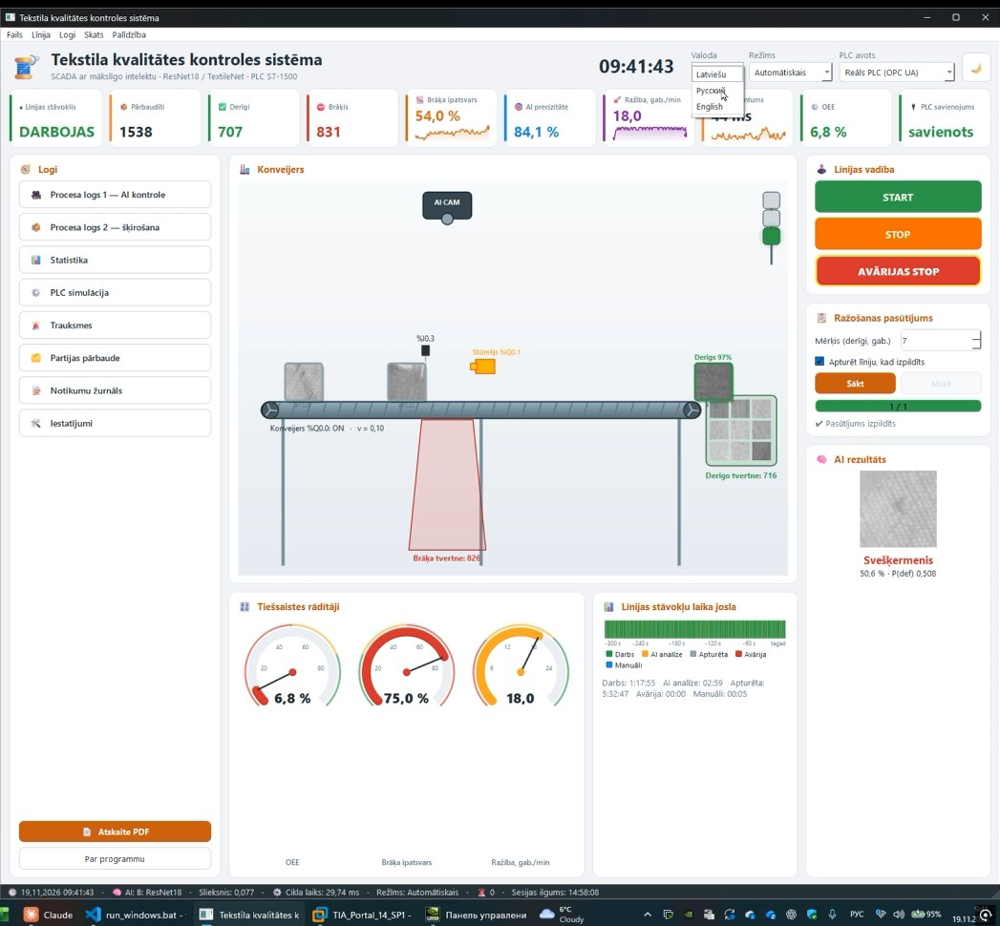
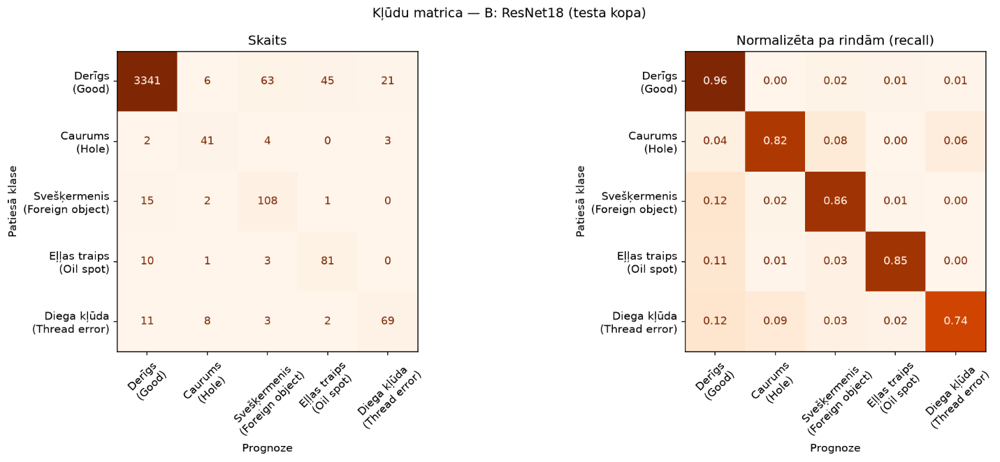
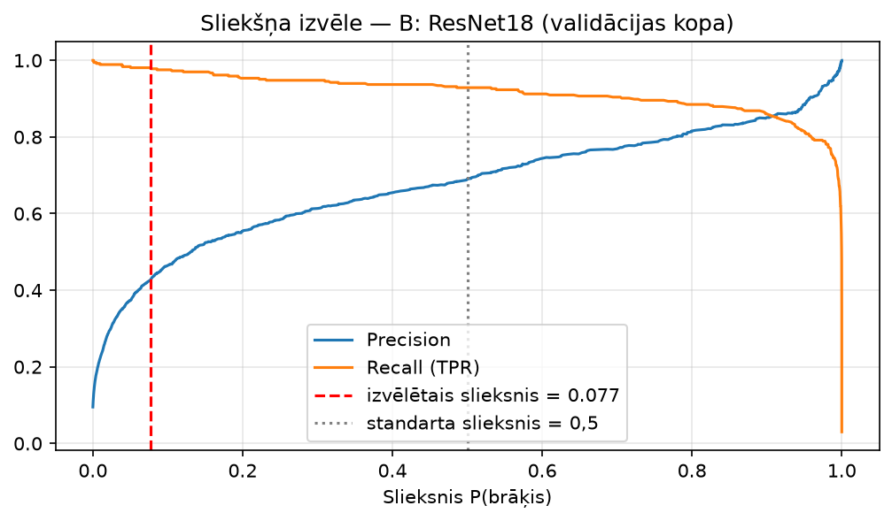
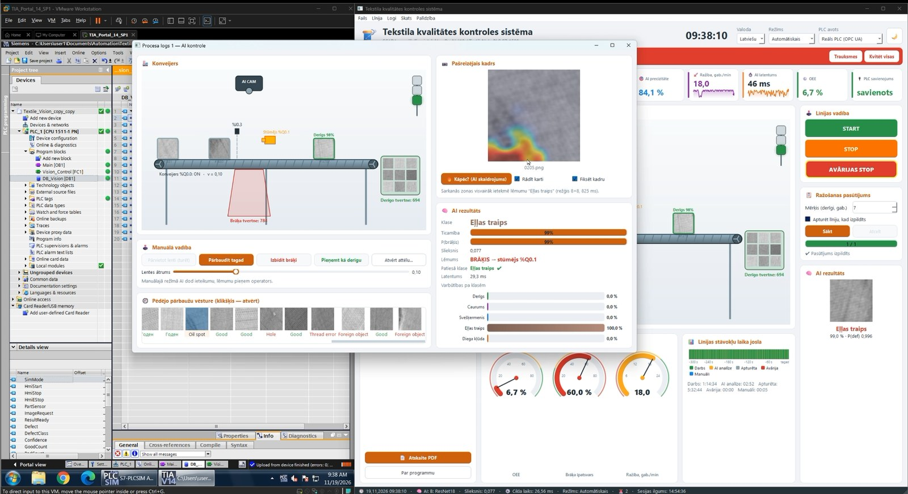
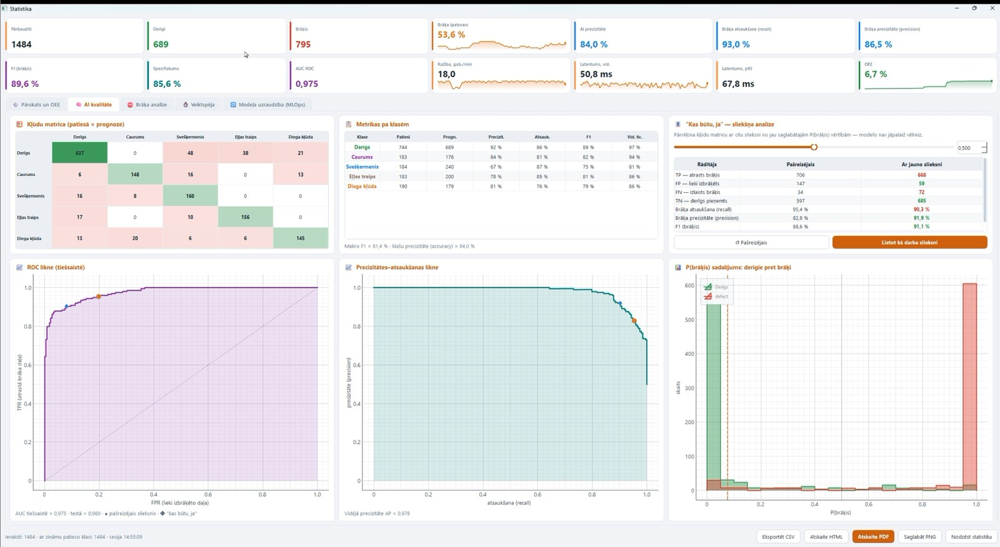
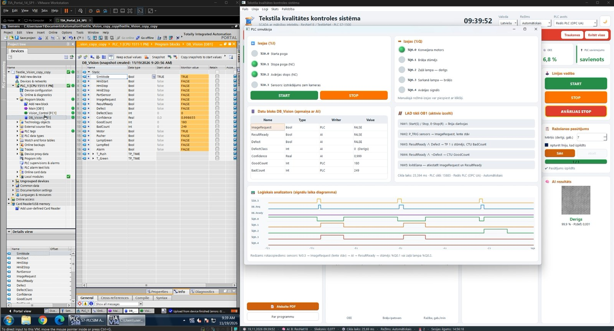

# Textile-Defect-Detection-AI

**Tekstila defektu kontroles sistēma ar mākslīgo intelektu un PLC Siemens S7-1500**
RTU studiju projekts, kurss „Datorvadība ražošanas sistēmās”, 2. variants (Python AI ražošanas projekts).
Autors: Eriks Stovba, 241RDB351 · 2026

> *EN: AI-based textile defect inspection line — ResNet18 classifier, PyQt6 SCADA app and Siemens S7-1500 PLC (TIA Portal, SCL) connected via OPC UA.*



## Kas tas ir

Kamera nofotografē auduma fragmentu uz konveijera, neironu tīkls **ResNet18** to klasificē 5 klasēs (derīgs, caurums, svešķermenis, eļļas traips, diega kļūda), un **PLC S7-1500** ar pneimatisko stūmēju izmet brāķi. Procesu vada un vizualizē **PyQt6 SCADA programma**, kas ar PLC sazinās caur **OPC UA**. Bez PLC programma strādā ar iebūvētu simulatoru, kam ir tāda pati loģika.

## Rezultāti

| Rādītājs (testa kopa, 3 840 attēli) | A: TextileNet | B: ResNet18 |
|---|---|---|
| Accuracy | 0,930 | **0,948** |
| Balanced accuracy | 0,822 | **0,847** |
| F1 makro | 0,737 | **0,781** |
| AUC ROC | 0,974 | **0,980** |
| Laiks uz attēlu (GPU) | 1,90 ms | 2,76 ms |

Ar slieksni **P(brāķis) ≥ 0,077** atrasti **94,2 %** brāķa (izlaistais brāķis 37 → 21). Programmā uz CPU lēmums aizņem ≈ 50 ms; PLC uz šo laiku aptur lenti.

## Repozitorija struktūra

```
notebook/                 Jupyter / Colab: datu kopa, sagatavošana, apmācība, novērtēšana, eksports
textile_scada_app/        PyQt6 SCADA programma
  main.py
  textile_scada/          core, windows, stats_window, extra_windows, widgets, theme, i18n
  model/                  šeit atpako ai_export.zip (textile_model_ts.pt, model_meta.json, demo_images/)
  requirements.txt
  run_windows.bat
tia/                      TIA Portal V14 SP1 projekts (arhīvs) + Vision_Control.scl
docs/                     projekta apraksts, prezentācija, ekrānuzņēmumi
```

## Palaišana

1. Python 3.10–3.12.
2. Atpakot `ai_export.zip` mapē `textile_scada_app/model`.
3. Windows: `run_windows.bat` (izveido `.venv` un uzstāda pakotnes).
   Citur: `pip install -r requirements.txt`, tad `python main.py`.

Darbam ar reālu PLC: **Iestatījumi (F9) → OPC UA** → adrese (piem. `opc.tcp://192.168.0.1:4840`), ns = 3, DB = `DB_Vision` → “Pārbaudīt savienojumu” → galvenajā logā PLC avots “Reāls PLC (OPC UA)”.

## AI modelis

- Datu kopa **TILDA** (Kaggle): 25 600 attēli 64 × 64, 90,5 % derīgi — spēcīgs disbalanss.
- Stratificēts dalījums 70 / 15 / 15, augmentācija, **WeightedRandomSampler**.
- Divi modeļi: savs **TextileNet** (Residual + Inception + Dense, 1,16 M param.) un **ResNet18** (transfer learning, 11,18 M param.).
- LR range tests, OneCycleLR, Adam, Dropout, L2, kontrolpunkti katrā epohā.
- Novērtēšana: kļūdu matrica, F1, ROC/AUC, sliekšņa izvēle, Grad-CAM.
- Eksports: TorchScript `textile_model_ts.pt` + `model_meta.json`.

<p>


</p>

## SCADA programma (PyQt6)

| Logs | Saturs |
|---|---|
| Galvenais logs | mnemoshēma, 10 KPI, spidometri, START / STOP / avārijas stops, ražošanas pasūtījums, stāvokļu laika josla |
| Procesa logs 1 — AI kontrole | kadrs, klase, varbūtības, lēmums, skaidrojuma karte (oklūzija 8 × 8) |
| Procesa logs 2 — šķirošana | tvertnes, stūmējs, brāķis pa veidiem |
| Statistika | 14 KPI, 5 cilnes: OEE, AI kvalitāte (ROC, PR, “kas būtu, ja”), Pareto, veiktspēja, MLOps dreifs |
| PLC simulācija | ieejas %I, izejas %Q, DB_Vision, tīkli NW1–NW5, loģiskais analizators |
| Papildu logi | trauksmes (ISA-18.2), partijas pārbaude, notikumu žurnāls, iestatījumi |

Automātiskais un manuālais režīms · latviešu / krievu / angļu valoda · gaišā un tumšā tēma · atskaites PDF / HTML / CSV.




## PLC un OPC UA (TIA Portal)

- CPU 1511-1 PN, S7-PLCSIM Advanced, OPC UA serveris portā 4840.
- `Main [OB1]` izsauc `Vision_Control [FC1]` (SCL), datu apmaiņa caur `DB_Vision` (19 mainīgie).
- OPC UA mezgli: `ns=3;s="DB_Vision"."ImageRequest"` u. c.
- Darba cikls: sensors %I0.3 → `ImageRequest` (lente apstājas) → AI → `ResultReady` + `Defect` → stūmējs %Q0.1 vai zaļā lampa → kvitēšana.

Pārbaudīts ar reālu PLC programmu: skaitītāji `GoodCount` / `BadCount` TIA Portal un SCADA programmā sakrīt.



## Prezentācija un video

- Prezentācija: [saite](LINK_PREZENTACIJA)
- Video (5:29): [saite](LINK_VIDEO)
- Projekta apraksts: [docs/Projekta_apraksts_Eriks_Stovba.docx](docs/Projekta_apraksts_Eriks_Stovba.docx)

## Tehnoloģijas

Python · PyTorch · torchvision · PyQt6 · pyqtgraph · asyncua · Siemens TIA Portal V14 SP1 · S7-PLCSIM Advanced · SCL
